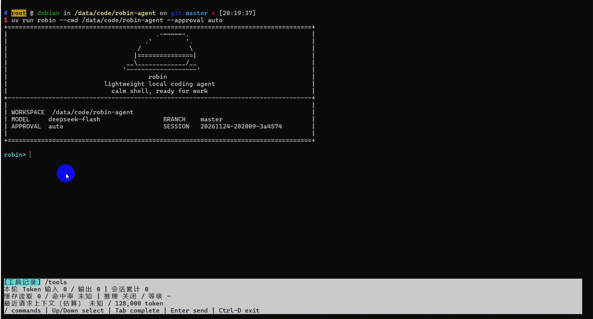

# Robin Agent

Robin 是一个优先面向 Linux 的本地命令行编码助手。通过自然语言，让模型读取项目、搜索代码、修改文件、运行测试，并保留可恢复的会话和可审计的执行记录。

项目使用 Python 和 uv，包名为 `robin`。它也用于学习 Agent 工程：从真实问题出发，研究上下文、工具执行、记忆和恢复机制，并记录设计取舍。



[架构详解](docs/agent-architecture.md) · [设计学习笔记](knowledge/agent-design/README.md) · [开发约定](CLAUDE.md)

## 已有能力

- 终端交互：可编辑输入、历史记录、`/` 菜单、工具参数展开和完整工具记录查看。
- 原生工具调用：读取、搜索、写入、精确替换文件及执行 Shell；单次响应中的多个调用顺序执行。
- 模型适配：通过 LiteLLM 对接 Chat Completions、OpenAI Responses、Anthropic Messages 和 Ollama Chat。
- 上下文管理：按模型窗口预算组织结构化历史，接近容量时生成进度摘要，也支持 `/compact` 手动压缩。
- 执行保护：参数与路径校验、危险工具审批、简单重复检测及工具预算硬限制。
- 记忆与恢复：工作记忆、长期项目记忆、会话恢复、checkpoint 和逐次运行的审计工件。
- 只读委派：使用独立子会话调查问题，结果和用量汇总给父 Agent。
- 状态展示：输入、输出、缓存命中、推理配置及最近请求上下文占用；等待模型和工具执行时保持底部显示。

## 在 Linux 上运行

需要 Python 3.10+ 和 uv。在 Robin 项目目录执行：

```sh
uv sync --locked
cp .env.example .env
# 编辑 .env，填写所用模型服务的地址、模型名和密钥。
uv run robin --help
uv run robin
```

执行一次任务，或指定工作区：

```sh
uv run robin "解释这个项目的结构"
uv run robin --cwd /path/to/project
```

在其他项目目录中启动时，使用 Robin 项目的绝对路径：

```sh
uv run --project /path/to/robin-agent robin --cwd /path/to/project
```

`uv run robin` 依赖当前 uv 项目中的入口；在未安装 Robin 的其他目录直接执行，可能提示找不到命令。

## 配置模型

完整配置项见 [.env.example](.env.example)。以下为 DeepSeek 配置示例，模型名须由实际服务支持：

```dotenv
ROBIN_PROVIDER=deepseek
ROBIN_API=anthropic-messages
ROBIN_DEEPSEEK_API_BASE=https://api.deepseek.com/anthropic
ROBIN_DEEPSEEK_API_KEY=替换为你的密钥
ROBIN_DEEPSEEK_MODEL=deepseek-v4-flash
```

| Provider | 默认协议 | 主要环境变量前缀 |
| --- | --- | --- |
| `deepseek` | `anthropic-messages` | `ROBIN_DEEPSEEK_` |
| `openai` | `responses` | `ROBIN_OPENAI_` |
| `anthropic` | `anthropic-messages` | `ROBIN_ANTHROPIC_` |
| `ollama` | `ollama-chat` | 地址使用 `--host`，模型使用 `--model` |

兼容网关可用 `--api chat-completions` 等参数显式选择协议，Robin 不根据域名猜测协议，也不自动尝试其他端点。模型名原样传给服务，路由前缀由适配层管理。

```sh
uv run robin --provider openai --api chat-completions \
  --base-url https://gateway.example/v1 --model your-model
uv run robin --provider ollama --model qwen3.5:4b
```

配置优先级为 CLI 参数 → 环境配置 → 默认值。注意：当前实现从目标工作区的仓库根目录向上查找 `.env`，加载时会覆盖同名 Shell 环境变量。使用 `--cwd` 切换项目时，请检查目标项目实际加载的配置；不会自动读取 Robin 安装目录里的 `.env`。

模型容量由本地配置提供，不是自动向服务查询：`--max-new-tokens` / `--context-window` → `ROBIN_MAX_NEW_TOKENS` / `ROBIN_CONTEXT_WINDOW` → 工作区仓库根目录的 `robin.models.json` → 默认输出 16,384、上下文 128,000 token。应填写网关与模型真正支持的上限。

## 命令与审批

输入 `/` 打开菜单，方向键选择、Tab 补全、Enter 执行。

| 命令 | 用途 |
| --- | --- |
| `/help` | 查看帮助 |
| `/memory` | 查看当前记忆 |
| `/session` | 查看会话文件位置 |
| `/tools` | 查看完整工具参数和执行记录，Esc/q 返回 |
| `/compact` | 手动压缩历史，保留原始会话记录 |
| `/reset` | 清空当前会话历史、记忆及用量统计 |
| `/exit`、`/quit` | 退出；也支持 Ctrl-D、Ctrl-C |

默认 `--approval ask`，执行 Shell、写文件和修改文件需要确认。长参数只预览前 20 个字符；Shell 审批中的 `[+]` 可点击展开。执行后的完整参数通过 `/tools` 查看。

| 策略 | 危险工具处理 |
| --- | --- |
| `ask` | 逐次确认，仅 `y` / `yes` 放行 |
| `auto` | 自动放行，但仍受参数、路径、重复保护和预算限制 |
| `never` | 拒绝危险工具 |

```sh
uv run robin --approval auto --max-steps 50
```

CLI 默认每轮最多尝试 50 次工具调用，校验失败和审批拒绝也占预算。耗尽后停止执行工具，最多再请求一次纯文本总结，并保留 `budget_exhausted` 状态。

审批不是操作系统沙箱：Shell 命令拥有当前用户权限，能够访问工作区外资源。请在可信目录和合适的系统权限下使用。

## 用量与上下文

底栏区分三种数字：本轮和会话累计用量来自接口；最近请求的上下文优先使用接口输入 token；请求尚未返回或缺少统计时，显示明确标注的本地估算。百分比的分母是配置的上下文窗口。

缺失计数显示“未知”，部分调用缺少统计时显示“不完整”，不将估算计入接口用量。缓存命中率来自缓存读取量与对应输入量；推理状态反映请求配置，不根据模型名称猜测。这些数字不表示费用。

## 恢复与审计

交互退出时会打印带当前 session ID 和工作区的恢复命令。也可手动执行：

```sh
uv run robin --cwd /path/to/project --resume latest
uv run robin --cwd /path/to/project --resume SESSION_ID
```

本地状态存放在目标仓库的 `.robin/`：

```text
.robin/
├── sessions/       # 结构化历史、记忆、用量、checkpoint
├── runs/           # 每次运行的 task_state.json、trace.jsonl、report.json
├── memory/         # 长期记忆与主题文件
└── tool-output/    # 脱敏后的大体积 Shell 输出
```

恢复会校验 checkpoint 的环境与文件新鲜度，但不保证任意副作用只执行一次。工具完成与保存结果之间存在崩溃窗口，详见[持久化与恢复边界](docs/agent-architecture.md#9-会话持久化与恢复)。大输出文件目前需要手动清理。

## 开发与构建

```sh
uv run pytest -q
uv run ruff check robin evaluation scripts tests
uv build
```

测试覆盖协议适配、工具执行、路径与审批、预算、上下文压缩、记忆、恢复和终端交互。测试使用 Fake 客户端或模拟传输，不需要真实密钥。

评测代码位于 `evaluation/`，脚本入口位于 `scripts/`，固定任务定义位于
`benchmarks/coding_tasks.json`；这些研发资产与测试样例一起纳入版本管理。
生产 wheel 仅包含 `robin` 包，评测需在源码仓库中运行：

```sh
uv run python scripts/run_benchmark.py
```

此命令使用确定性模拟客户端验证执行机制，不代表真实模型的任务成功率。
生成的报告与工作区写入 `artifacts/`，不纳入版本管理。
其他实验脚本可通过 `--help` 查看参数；供应商实验会请求真实模型服务。

`uv build` 生成 wheel 和源码包，运行仍需 Python；当前没有独立 Linux 可执行文件。终端交互已经实现，模型输出目前为同步非流式。

阅读源码可从 `Robin.ask()` → `AgentLoop.run()` → 模型适配与工具执行开始。完整分层图、调用链及限制见[架构详解](docs/agent-architecture.md)。

## 许可证

本项目采用 [MIT 许可证](LICENSE)。第三方依赖遵循各自的许可证。
