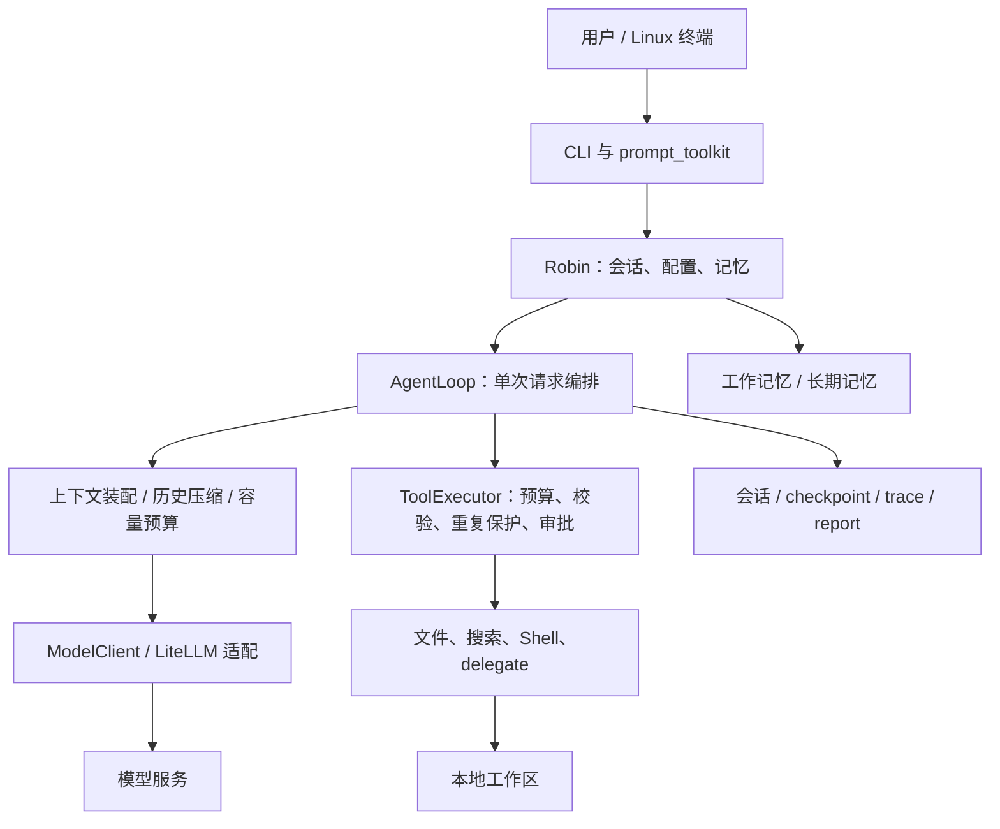
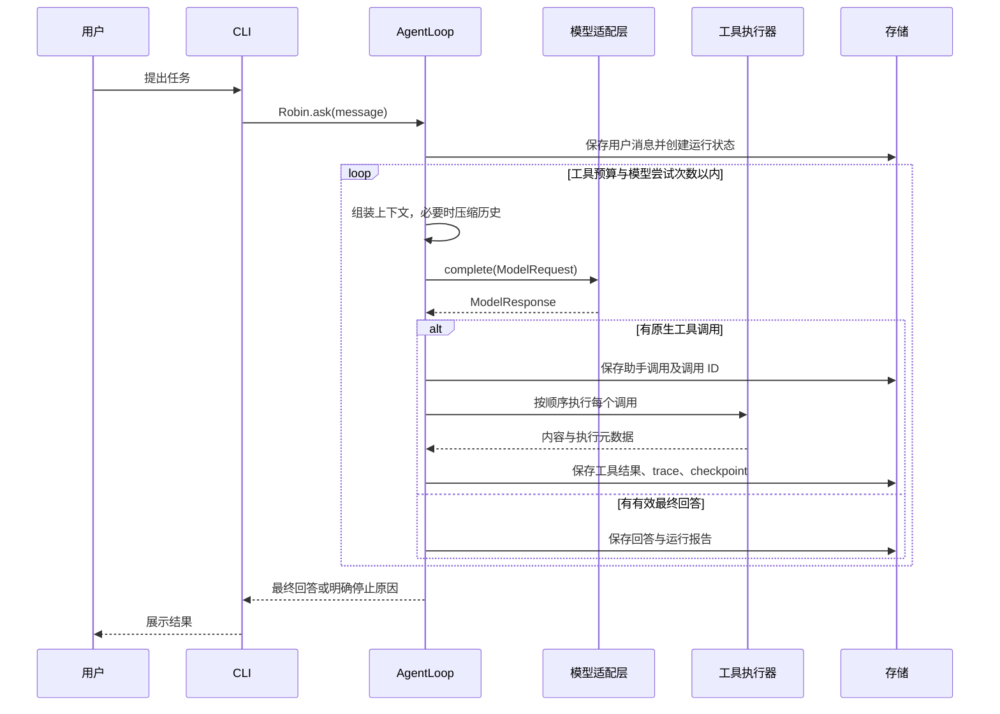
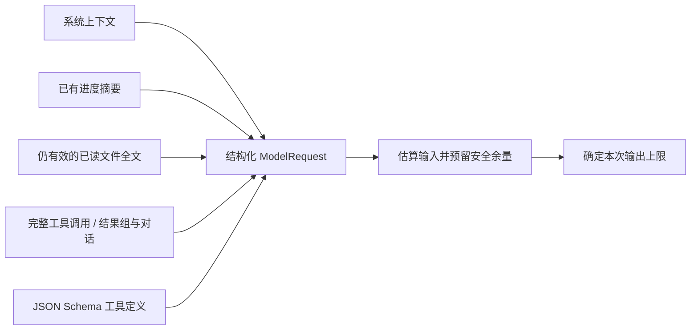
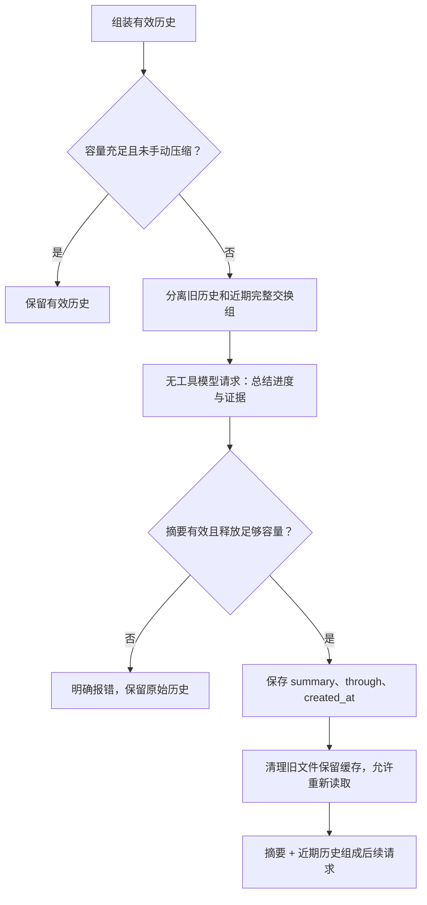
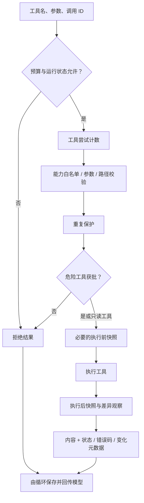

# Robin 架构详解

本文解释 Robin 如何把一句用户需求变成“读取代码、修改文件、运行验证、保存结果”的过程，面向源码学习与面试复盘。描述对应当前实现，不把设计建议写成已有能力。

Robin 使用 Python，优先运行在 Linux 终端。模型负责提出动作，宿主程序负责组装上下文、执行校验与审批、调用工具、记录结果并决定何时停止。模型本身不能直接获得 Python 函数的执行权限。

## 导航

1. [全景与一次请求](#1-全景与一次请求)
2. [核心循环与停止条件](#2-核心循环与停止条件)
3. [供应商适配与结构化协议](#3-供应商适配与结构化协议)
4. [上下文装配与容量预算](#4-上下文装配与容量预算)
5. [历史压缩与内容保留](#5-历史压缩与内容保留)
6. [工具执行与文件观察](#6-工具执行与文件观察)
7. [审批与安全边界](#7-审批与安全边界)
8. [记忆与只读委派](#8-记忆与只读委派)
9. [会话持久化与恢复](#9-会话持久化与恢复)
10. [终端与用量可观测性](#10-终端与用量可观测性)
11. [配置与扩展入口](#11-配置与扩展入口)
12. [验证方法与当前限制](#12-验证方法与当前限制)

## 1. 全景与一次请求

可以把 Robin 看作一个围绕模型运行的控制程序。CLI 装配模型客户端、工作区、存储和策略；`Robin` 持有这些状态；`AgentLoop` 编排单次用户请求；执行器统一处理工具护栏。



这里是职责分层，不是严格的单向模块依赖：核心循环、工具执行器和历史压缩目前都直接引用终端动画，`Robin` 也仍承担较多装配与状态协调工作。当前没有独立 UI 事件总线。



一次 session 可以跨多次用户输入；一次 `ask()` 创建新的 task/run。恢复旧 session 后继续提问，也会创建新运行，并非恢复崩溃进程的程序计数器。

源码入口：[CLI](../robin/cli.py) 的 `build_agent`、[运行时](../robin/runtime.py) 的 `Robin.ask`、[核心循环](../robin/agent_loop.py) 的 `AgentLoop.run`。

## 2. 核心循环与停止条件

核心循环不断执行“组装上下文 → 请求模型 → 执行工具 → 保存反馈”。工具结果以结构化消息回传，模型根据实际成功、拒绝或失败决定下一步。

有工具调用时优先处理工具；无工具调用且有有效回答文本时结束。空响应会进入有限的重答流程。长度截断或异常停止会使请求失败，截断响应里的工具不执行；推理内容不会作为最终回答展示。

### 两种计数不能混用

| 计数 | 含义 | 限制 |
| --- | --- | --- |
| `tool_steps` | 预算内的工具尝试，含参数错误和审批拒绝 | CLI 默认 50；直接构造 `Robin` 默认 6 |
| `attempts` | 循环级模型尝试 | 常规尝试上限为 `max(max_steps × 3, max_steps + 4)` |
| 接口用量调用数 | 实际模型调用，包括适配重试、压缩和子任务 | 用于统计，与上述计数不等同 |

工具失败通常作为工具结果回传，不一定立刻结束整轮任务。不能仅凭状态类定义了某个停止原因，就声称所有工具错误都会触发它。

### 预算硬限制

当工具预算耗尽，执行器拒绝后续工具。同一批次里未执行的调用也会获得对应调用 ID 的预算拒绝结果。随后最多再请求一次不带工具定义的总结；即使模型尝试继续调用工具，也不会执行。

终端明确显示“工具预算已耗尽：50/50，任务未完成”。总结成功或失败都不覆盖 `stopped / budget_exhausted`，避免一段礼貌总结把未完成任务误记成成功。

常规模型响应被接受为最终回答时，运行记录 `completed / final_answer_returned`。这只代表循环正常收尾，不证明代码正确、测试通过或用户目标已经实际满足。

源码入口：[核心循环](../robin/agent_loop.py) 的 `_request_model`、`run`；[任务状态](../robin/task_state.py) 的 `TaskState`。

## 3. 供应商适配与结构化协议

Robin 通过 LiteLLM 库处理供应商传输与协议转换，不部署 LiteLLM Proxy。业务层依赖统一模型接口，新增供应商或协议应优先在适配层完成。

| 类型 | 职责 |
| --- | --- |
| `ModelRequest` | 消息、JSON Schema 工具定义、输出预算、缓存键、收尾标记 |
| `ModelResponse` | 回答文本、独立推理、工具调用、停止原因、用量及必要回放字段 |
| `ToolCall` | 调用 ID、工具名和参数 |
| `ToolResult` | 通过调用 ID 关联工具结果 |
| `Usage` | 输入、输出、缓存读取与缓存写入计数，缺失值保持未知 |

只执行原生工具调用；普通回答中出现 XML、`<tool>` 或 DSML 示例，都只是文本。这样把“模型说了一段像命令的文字”和“模型请求调用工具”区分开，避免自定义文本解析带来的歧义。

默认协议映射：OpenAI → Responses，Anthropic / DeepSeek → Anthropic Messages，Ollama → Ollama Chat；Chat Completions 可显式选择。协议优先级为 CLI → 环境配置 → provider 默认值，不根据地址或模型名切换端点。

当前请求使用 `stream=False`。适配层对指定的超时、限流和服务端错误最多尝试三次，使用有限退避，不切换供应商或端点。未知参数不静默丢弃；认证错误等最终异常会脱敏后上报。Anthropic 兼容链路额外携带 Bearer 认证头以支持相应网关。

推理、回答与不透明回放信息分开保存，仅按后端需要回传。DeepSeek 和 Ollama 当前明确关闭推理；其他配置不依据模型名推断等级。

源码入口：[统一类型](../robin/providers/types.py)；[适配器](../robin/providers/clients.py) 的 `LiteLLMModelClient.complete`、`normalize_response`、`reported_usage`。

## 4. 上下文装配与容量预算

模型每次请求都需要重新获得任务相关信息。Robin 同时存在“系统上下文的字符预算”和“原生消息的 token 容量预算”，二者不能混为一谈。

### 系统上下文

工作区 Git 信息、工具说明、当前任务、记忆和 checkpoint 等经过上下文管理器组织。默认字符预算总计 12,000，分段预算包括 prefix 3,600、memory 1,600、relevant_memory 1,200、history 5,200。

但原生模型消息中的对话历史**不受 5,200 字符历史段直接截断**。模型系统文本与结构化历史分别装配，后者使用下面的容量机制。

### 原生模型请求

请求包含系统指令、压缩摘要、仍保留的文件全文和压缩边界之后的有效消息。工具调用与结果按调用 ID 成组；缺少结果的中断调用组不会直接发送给后端，避免非法协议序列。这里的“跳过不完整组”不是崩溃恢复核验。



模型容量配置顺序为 CLI → 环境变量 → 仓库根目录的 `robin.models.json` → 默认值。默认输出上限 16,384、上下文窗口 128,000 token，均是本地兜底值，不是服务发现的能力。

```json
{
  "deepseek": {
    "your-model": {"maxTokens": 16384, "contextWindow": 128000}
  }
}
```

每次发送前，输出上限取“配置输出”和“窗口减估算输入减 4,096 安全余量”的较小值。输入估算包含消息和工具定义，采用 ASCII 约三字符一个 token、非 ASCII 每字符约两个 token，再加消息开销。它不是模型 tokenizer 的精确计数，可能提前压缩或缩小输出预算；没有剩余空间时直接报错，不发送请求。

源码入口：[上下文管理器](../robin/context_manager.py) 的 `ContextManager.build`；[原生请求](../robin/providers/context.py) 的 `build_request`；[容量计算](../robin/providers/limits.py) 的 `estimate_input`、`output_budget`。

## 5. 历史压缩与内容保留

Robin 的目标是先让模型读到必要信息，再优化上下文开销。容量充足时保留有效历史，不按固定轮数丢弃。接近窗口上限时，将较早消息总结为进度 checkpoint，近期消息仍按完整工具交换组保留。



摘要要求区分目标、约束、决策、已完成工作、失败修改、未完成步骤、测试证据和相关文件。它是有损归纳，不保证每个细节都保留，因此原始 `session.history` 不删除，只保存压缩边界。

近期目标约为 20,000 估算 token，小窗口会缩小。单个近期交换组无法容纳、摘要失败或摘要释放空间不足时，会明确停止而非静默删掉正文。压缩请求也计入用量。

`/compact` 允许提前压缩；空会话或无新增可压缩历史时不请求模型，短会话可整体总结。成功压缩后清空旧读取范围和全文保留缓存，因为“过去读过”不代表“现在模型还能看到”。

### 文件重读以可见内容和版本为准

`read_file` 结果包含实际返回范围和续读游标。已读范围合并后，如果最近一个不超过 12,000 字节的文件已经完整读完，会将其全文保留到后续模型请求中，作为数据块发送。

只有同一用户轮次、内容 hash 未变、全文已实际纳入请求且仍在保留缓存中，才拒绝重复读取并提示复用。部分范围没有单纯按次数拒绝的限制；文件改变、缓存淘汰、历史压缩或 reset 后允许重新读取。即使 mtime 和大小相同，内容 hash 改变也视为新版本。

缓存校验使用不跟随符号链接、非阻塞的打开方式，检查普通文件类型并限制读取字节数，避免缓存校验因文件被替换成 FIFO 等对象而挂住。这不等于所有文件读取路径都已实现有界流式读取。

源码入口：[历史压缩](../robin/history_compaction.py) 的 `compact_history`；[执行器](../robin/tool_executor.py) 的 `read_context`、`execute`；[输出分页](../robin/tool_output.py) 的 `read_page`。

## 6. 工具执行与文件观察

工具定义由白名单生成 JSON Schema，保留字段类型、必填项和默认值。底层工具通过窄 `ToolContext` 获取路径解析、环境和委派能力，而非直接依赖整个运行时。

| 工具 | 主要行为 |
| --- | --- |
| `list_files` | 列出工作区文件 |
| `read_file` | 读取文件行范围，结果带分页游标 |
| `search` | 在工作区搜索文本 |
| `write_file` | 写入文本，必要时创建父目录 |
| `patch_file` | 精确替换，旧文本必须恰好出现一次 |
| `run_shell` | 在工作区目录执行 Shell，返回退出码、stdout、stderr |
| `delegate` | 在深度限制内启动只读调查子任务 |



图中校验、重复保护任一步失败也返回拒绝结果。多个调用按顺序执行，每个独立校验、审批和计步，没有工具批次并发或自动回滚。

### 输出与副作用观察

文件结果按完整行限制在约 4,000 字符以内，`read_page` 标记给出 start、next、total；上下文缩减结果时会重新计算游标，避免跳过未返回的行。超长单行会明确提示不能完整返回。

较大 Shell 输出保存为 `.robin/tool-output/` 下的随机脱敏文件，预览保留退出码和完整输出路径。但 Shell 本身使用 `capture_output=True`，输出先进入内存；落盘预览不是执行期间的内存限额。

write/patch 只观察校验后的目标文件，内容快照上限 2 MiB，超过时退回元数据。Shell 快照比较文件元数据，剪枝依赖、缓存和构建目录，最多观察 2,000 条目录项，约一秒后停止遍历。底层文件系统调用本身不能靠这个时间检查强制中断。

快照的不完整性会写入元数据。`workspace_changed=false` 只能说明观察范围内未发现变化，不代表完整文件系统没有副作用，也不是事务撤销机制。

### 简单重复保护仍有边界

除 `read_file` 的版本与内容规则外，通用保护在当前用户轮次拒绝第三次连续相同调用，以及第四次形成 A/B/A/B 的调用。比较的是工具名与结构化参数，不分析 Shell 语义，也不可靠判断任务是否取得进展，可能误判合理重复或漏掉改写命令的循环。`auto` 不取消保护，预算也独立生效。

源码入口：[工具定义与实现](../robin/tools.py)；[执行器](../robin/tool_executor.py) 的 `_execute_approved`；[快照](../robin/snapshots.py)；[运行时](../robin/runtime.py) 的 `repeated_tool_call`。

## 7. 审批与安全边界

文件工具经路径解析限制在工作区，拒绝越界路径和符号链接逃逸；参数校验与能力白名单在执行前运行。`ask` 请求人工批准，`auto` 自动批准危险工具，`never` 拒绝危险工具。只读子代理另外受 `read_only` 限制。

但 `run_shell` 使用系统 Shell 和当前用户权限。文件工具的路径围栏不等于 Shell 的文件系统隔离，Shell 仍可能执行绝对路径访问、网络请求和外部进程。当前没有容器、seccomp 或其他操作系统沙箱。

Shell 默认超时 20 秒，参数允许 1–120 秒。它是短命令接口，不是带进程 ID、日志订阅和可靠清理的后台服务管理器；用 `nohup` 或 `&` 启动服务不能获得此类生命周期保证。

传给 Shell 的环境使用白名单过滤，trace、report 和工具历史显示使用脱敏逻辑。脱敏只覆盖已识别的敏感键与值，不保证任意 session 内容都没有秘密；会话、工件与配置仍应作为本地敏感资料处理。

源码入口：[安全工具](../robin/security.py)；[文件与 Shell 实现](../robin/tools.py)；[审批](../robin/runtime.py) 的 `approve`。

## 8. 记忆与只读委派

Robin 将不同用途的信息分开：原始历史保留事实，工作记忆保留当前重点，长期记忆保存可复用约定。压缩摘要用于续接对话，与长期知识不是同一存储。

| 层次 | 内容与生命周期 |
| --- | --- |
| 工作记忆 | 当前任务、近期文件、最多 12 条过程笔记与 6 条文件摘要，随 session 保存 |
| 长期记忆 | `.robin/memory/MEMORY.md` 与主题文件，跨任务召回 |
| 进度摘要 | 历史压缩产生的 summary 和边界，保留目标、失败与待办 |
| checkpoint | 目标、步骤、阻塞、关键文件与运行环境，用于恢复校验 |

长期记忆提升依赖明确前缀，例如“项目约定：”“决策：”“依赖：”“偏好：”及对应英文前缀。它不是自动验证后的知识库，也不意味着每段模型回答都变成可信事实。

`delegate` 创建独立子 session，复用模型客户端、工作区和存储，默认工具预算 3，使用 `never` 审批及只读限制。它同步执行调查，将结论作为父代理的工具结果返回；用量沿父链累计。子任务不会自动获得父任务的全部上下文，只携带受限的任务与历史提示，且受最大深度控制。

仓库中的 [agent-learning skill](../.agents/skills/agent-learning/SKILL.md) 服务于开发 Robin 的助手，负责研究笔记沉淀；它不是 Robin 运行时已经实现的通用 Skill 加载系统。

源码入口：[记忆](../robin/features/memory.py)；[运行时](../robin/runtime.py) 的 `spawn_delegate`、`record_usage`、`promote_durable_memory`。

## 9. 会话持久化与恢复

| 工件 | 回答的问题 |
| --- | --- |
| `.robin/sessions/<id>.json` | 用户和模型说过什么、调用了什么、结果是什么，以及记忆、用量和 checkpoint |
| `.robin/runs/<run_id>/task_state.json` | 本次运行状态、步骤、尝试次数与停止原因 |
| `.robin/runs/<run_id>/trace.jsonl` | 模型、工具、checkpoint 等事件的执行时间线 |
| `.robin/runs/<run_id>/report.json` | 运行结束后的汇总、上下文元数据和记忆提升情况 |

session 格式版本为 2。旧历史加载为明确标注的历史摘要，不伪造原生工具调用 ID；旧用量继续保留，缺失的早期用量无法补算。

恢复检查 schema、运行环境及关键文件新鲜度，可能得到 `no-checkpoint`、`full-valid`、`partial-stale`、`workspace-mismatch` 或 `schema-mismatch`。过期和不匹配信息会进入后续上下文，提示重新确认现场。

`--resume latest` 选择当前 session 存储目录中最近修改的文件，不保证它就是上一次交互主会话；delegate 也会创建 session。需要精确恢复时使用退出提示中的 session ID。

### 当前不能承诺任意工具只执行一次

当前顺序为“保存助手工具调用 → 执行工具 → 保存工具结果”。如果副作用已经发生，但进程在保存结果前崩溃，就会留下有调用、无结果的记录。恢复时不完整消息组会被过滤，模型仍可能重新提出相同动作。

当前 session 的 `save()` 使用直接 `write_text()`，没有临时文件、刷盘和原子替换，存在半写入风险。session、trace 与 checkpoint 之间也没有统一事务。

此前讨论的改进是：执行前可靠落盘 intent，包含 operation_id、规范参数、输入版本和预期后置条件；执行后保存 observed result 与提交状态。恢复时将未终结 intent 视为 unknown，先核验效果；确认未发生且可安全幂等执行才重试，外部不可逆或无法判断的动作交人工。**该机制尚未实现**，日志本身也不能提供任意 Shell 的 exactly-once。

源码入口：[会话存储](../robin/session_store.py) 的 `SessionStore.save`；[恢复校验](../robin/checkpoint.py) 的 `evaluate_resume_state`；[运行工件](../robin/run_store.py)；[核心循环](../robin/agent_loop.py) 的工具结果记录顺序。

## 10. 终端与用量可观测性

输入使用 prompt_toolkit，支持退格、光标、历史和 `/` 菜单。普通对话输出保留在终端滚动区，`/tools` 打开独立全屏记录视图，通过调用 ID 关联结果，可查看已经执行或中断的调用。历史滚动区中的普通文本不具有永久点击回调。

审批阶段可点击 Shell 参数前的 `[+]` 展开；工具运行提示与完成行保留摘要，完整命令通过记录视图查看。非交互审批展示完整参数。

等待模型、执行工具和压缩历史时，由运行动画读取同一状态回调，通过终端光标控制将状态放到底部，和运行提示隔开。不变化的底栏文字不在每个动画帧重绘；结束时清理临时显示。它是同步程序上的终端绘制方案，并非持续运行的全屏 TUI 应用或模型流式输出。

| 显示项 | 数据来源与含义 |
| --- | --- |
| 本轮 Token | 同一次用户请求的模型调用汇总，含重试、压缩和 delegate |
| 会话累计 | 保存到 session 的输入与输出累计，resume 恢复，reset 清空 |
| 缓存读取 / 命中率 | 接口缓存读取量 / 对应总输入量，缓存写入不算命中 |
| 最近请求上下文 | 优先采用常规请求返回的输入 token；尚未返回或缺失时显示本地估算 |
| 上下文百分比 | 最近请求输入量 / 配置的上下文窗口，不是累计用量百分比 |
| 推理状态与等级 | 实际请求配置，未显式配置的等级显示缺失标记 |

Anthropic 总输入统计包含普通输入、缓存读取和缓存写入。接口缺字段时保留未知，部分调用缺字段时标记不完整；适配层不将 LiteLLM 自动补的零误当作接口上报。当前上下文显示不是对未来下一次请求的精确预测，手动压缩后的准备请求也可能显示为估算。

源码入口：[终端](../robin/terminal.py) 的 `TerminalInput`、`tool_activity`；[用量](../robin/usage.py) 的 `status_lines`、`add_usage`；[适配器](../robin/providers/clients.py) 的 `reported_usage`。

## 11. 配置与扩展入口

CLI 从目标工作区确定仓库根目录，向上寻找 `.env`，加载后装配模型和存储。`.env` 当前会覆盖同名进程环境变量；CLI 显式参数仍优先。模型容量配置文件位于仓库根目录，模型标识按 provider 和 model 精确查找，不根据模型名猜测容量。

| 扩展目标 | 修改入口与需要保持的约束 |
| --- | --- |
| 新供应商或协议 | `ModelClient` 与适配层，循环继续消费统一响应 |
| 新工具 | 工具定义、runner、示例与执行校验保持一致，新增安全测试 |
| 新上下文来源 | 同时纳入请求预算、压缩及敏感信息处理 |
| 新运行配置 | 检查是否影响 checkpoint 的 runtime identity |
| 新终端交互 | 同时验证交互终端与管道模式，避免只改显示而改变执行参数 |

当前没有 Robin 运行时的 MCP、插件、任务调度或远程工作区管理。开发助手可用的外部工具不等于 Robin 已有的产品能力。

## 12. 验证方法与当前限制

从项目根目录执行：

```sh
uv run pytest -q
uv run ruff check robin tests
uv build
```

测试覆盖统一协议、模拟传输、工具调用 ID、多工具顺序执行、审批、非法参数、预算耗尽、用量、压缩、文件重读、恢复和终端输入。Fake 客户端和模拟传输用于隔离网络，测试通过不等于真实网关必然兼容，也不等于终端在所有 SSH 客户端上的视觉表现一致。

推荐阅读测试入口：`test_native_loop.py`、`test_model_adapter.py`、`test_history_compaction.py`、`test_tool_output.py`、`test_security.py`、`test_terminal.py` 和 `test_cli_exit.py`，均位于 [tests](../tests/)。

当前最值得继续改进的方向包括：可靠持久化与副作用核验、模型 tokenizer 与预算准确度、基于进展的循环识别、Shell 输出内存限制、进程生命周期，以及核心与终端显示解耦。这些是工程边界，不应仅靠提示词宣称已经解决。

### 阅读与复盘问题

1. 为什么工具预算耗尽后的总结不能把运行状态改成 completed？
2. 原始 history、压缩摘要、工作记忆和恢复 checkpoint 各自解决什么问题？
3. 为什么内容 hash 不变，还不能仅凭“以前读过”拒绝重读？
4. 为什么调用日志与 checkpoint 无法单独保证任意 Shell 的 exactly-once？
